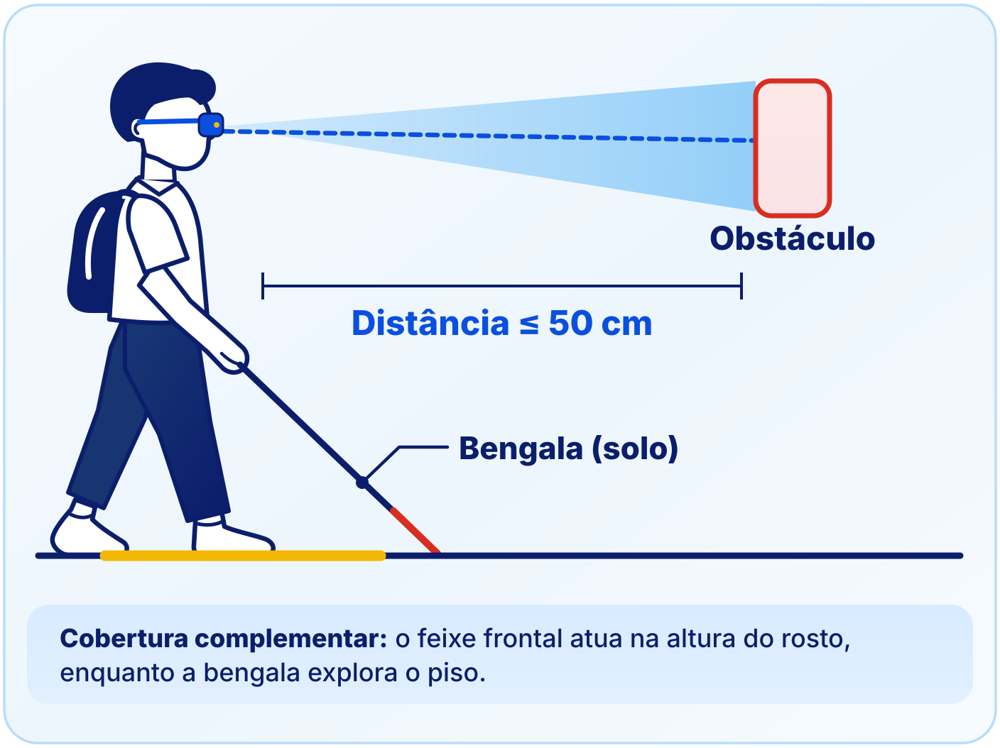
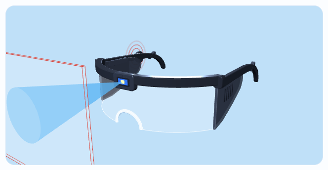

<div align="center">
  <picture>
    <source media="(prefers-color-scheme: dark)" srcset="Divulgacao/logos/guiacampus-horizontal-assinatura-negativo.svg" />
    <source media="(prefers-color-scheme: light)" srcset="Divulgacao/logos/guiacampus-horizontal-assinatura.svg" />
    
  </picture>

  <p>
    <strong>Óculos IoT de baixo custo para navegação assistida de pessoas com deficiência visual.</strong><br />
    Detecção frontal a laser na altura da cabeça, alerta tátil autônomo na haste e telemetria em tempo real via Web Bluetooth.
  </p>

  <p>
    
    
    
    
    
    
  </p>

  <p>
    <a href="#sobre-o-projeto">Sobre</a> &middot;
    <a href="#protótipo-3d">Protótipo 3D</a> &middot;
    <a href="#arquitetura-da-solução">Arquitetura</a> &middot;
    <a href="#como-executar">Como executar</a> &middot;
    <a href="#estrutura-do-repositório">Estrutura</a> &middot;
    <a href="#equipe">Equipe</a>
  </p>
</div>

---

## Sobre o projeto

O **GuiaCampus** é uma tecnologia assistiva vestível em formato de óculos inteligente desenvolvida no contexto do Trabalho Interdisciplinar 5 (TI5 — Ciência da Computação, PUC Minas). O dispositivo atua como um complemento à bengala branca, protegendo a região superior do corpo contra obstáculos suspensos ou na altura do rosto — como galhos, placas, orelhões e extintores — que ficam fora da área de varredura do piso.

Quando um obstáculo entra no limiar configurado (`<= 50 cm`), um atuador háptico embutido na haste dispara vibração localmente, sem depender de celular, servidor ou internet. Em paralelo, o microcontrolador transmite pacotes binários via **Bluetooth Low Energy (BLE)** para uma central web de monitoramento e diagnóstico diretamente no navegador.

<div align="center">
  
</div>

---

## Protótipo 3D

O modelo tridimensional dos óculos integra o visor curvo em policarbonato com recorte nasal aberto, o sensor frontal **VL53L0X** centralizado na ponte, o alojamento lateral esquerdo com **ESP32-C3 SuperMini** e **MPU6500**, e o berço traseiro do **Coin Motor 1027**.

<div align="center">
  <a href="Divulgacao/modelo-3d/oculos-guiacampus.stl" title="Abrir modelo 3D interativo no visualizador STL do GitHub">
    
  </a>
  <p>
    <a href="Divulgacao/modelo-3d/oculos-guiacampus.stl"><strong>Abrir modelo 3D interativo no GitHub (.stl)</strong></a>
    &nbsp;|&nbsp;
    <a href="Codigo/web/src/components/3d/oculos-guiacampus-3d.tsx">Código-fonte Three.js (<code>oculos-guiacampus-3d.tsx</code>)</a>
  </p>
</div>

> **Dica:** o Markdown do GitHub não executa WebGL diretamente na página do README, mas clicar na imagem ou no link `.stl` acima abre o **visualizador 3D interativo nativo do GitHub** (rotação, zoom e inspeção de malha). Na aplicação web (`/`), o componente Three.js adiciona simulação interativa de distância do obstáculo, cone de laser e anéis de vibração.

---

## Arquitetura da solução

A solução é dividida em duas partes acopladas por um contrato BLE somente leitura (`NOTIFY`) de **20 bytes** em ~5 Hz:

### 1. Hardware e Firmware (`Codigo/esp32`)

| Componente | Função | Interface / Configuração |
| --- | --- | --- |
| **ESP32-C3 SuperMini** | Controle local, leitura I2C e anúncio BLE (`GuiaCampus-01`) | USB-C voltado para baixo; I2C em GPIO 6 (SDA) e GPIO 7 (SCL) a 100 kHz |
| **VL53L0X** | Sensor frontal de distância a laser (Time-of-Flight) | I2C endereço `0x29`; limiar de alerta `<= 500 mm` |
| **MPU6500** | Unidade de medida inercial de 6 eixos (acelerômetro e giroscópio) | I2C endereço `0x68`; cálculo de `pitch` e `roll` no firmware |
| **Coin Motor 1027** | Alerta háptico na haste esquerda | Acionamento via transistor no GPIO 3; PWM `160/255` |

- **Autonomia física:** a decisão de acionar ou desligar o motor ocorre integralmente no ESP32-C3.
- **Segurança em leituras inválidas:** quando o `VL53L0X` retorna `RangeStatus != 0`, `0` ou `65535`, o motor permanece desligado e a telemetria sinaliza explicitamente medição indisponível (risco desconhecido), sem mascarar falhas como zero ou caminho livre.

### 2. Central Web de Monitoramento (`Codigo/web`)

- **Landing page (`/`):** apresenta o problema, o protótipo 3D interativo em Three.js, a arquitetura real do pacote BLE e os integrantes do projeto.
- **Central BLE (`/monitor`):** conecta diretamente ao `GuiaCampus-01` via **Web Bluetooth** (Chrome desktop/Android em HTTPS ou `localhost`), exibindo distância frontal, status do motor, orientação 2D (`pitch` e `roll`), gráficos em tempo real, histórico de eventos e exportação de sessões em CSV.
- **Modo Demonstração:** permite testar e apresentar toda a interface sem hardware físico, com cenários simulados claramente identificados.
- **Acessibilidade:** navegação integral por teclado, semântica ARIA calibrada para leitores de tela e contraste em conformidade com **WCAG 2.1 nível AA**.

### Visão futura (fora do MVP BLE atual)

Evoluções planejadas para etapas posteriores incluem expansão para múltiplos sensores ToF, escalonamento multitarefa com FreeRTOS para detecção de quedas, telemetria em nuvem via Wi-Fi/MQTT e mapeamento institucional de obstáculos no campus.

---

## Tecnologias utilizadas

| Camada | Tecnologias |
| --- | --- |
| **Firmware** | C/C++ (Arduino/ESP32), Wire (I2C), Adafruit VL53L0X, BLE Server |
| **Comunicação** | I2C (100 kHz), Bluetooth Low Energy (GATT `NOTIFY`, pacote binário little-endian de 20 bytes) |
| **Aplicação Web** | Next.js 16 (App Router), React 19, TypeScript, Tailwind CSS 4, Radix UI / shadcn/ui, Recharts, Zod, Web Bluetooth API |
| **Visualização 3D & Design** | Three.js, identidade visual documentada em [`DESIGN.md`](DESIGN.md) e logos vetoriais em [`Divulgacao/logos`](Divulgacao/logos) |
| **Qualidade & Testes** | Vitest (suíte automatizada de protocolo BLE, cliente GATT e telemetria), TypeScript strict |

---

## Como executar

Detalhes completos de integração e protocolo estão em [`Codigo/README.md`](Codigo/README.md).

### Firmware (ESP32-C3)

1. Instale o Arduino IDE com o pacote **esp32 by Espressif Systems** (suporte ao ESP32-C3).
2. Instale a biblioteca **Adafruit VL53L0X** pelo Gerenciador de Bibliotecas.
3. Abra [`Codigo/esp32/guiacampus/guiacampus.ino`](Codigo/esp32/guiacampus/guiacampus.ino), selecione a placa ESP32-C3 e faça o upload.
4. No monitor serial (`115200 baud`), o dispositivo anuncia **`GuiaCampus-01`** por BLE. Use `c` para calibrar a posição neutra da IMU e `r` para limpar a calibração em RAM.

Pinagem completa e detalhes em [`Codigo/esp32/README.md`](Codigo/esp32/README.md).

### Aplicação web

Requisitos: **Node.js 22.12+** e **npm**.

```bash
cd Codigo/web
npm ci
npm run dev
```

Acesse <http://127.0.0.1:3000> para a página inicial (com o modelo 3D interativo) ou <http://127.0.0.1:3000/monitor> para a central BLE. No Chrome, selecione **Real -> Conectar BLE -> GuiaCampus-01** ou utilize o modo **Demonstração** sem hardware.

#### Validação local

```bash
cd Codigo/web
npm test          # Suíte Vitest (protocolo BLE, cliente e telemetria)
npm run typecheck # Checagem estática TypeScript
npm run build     # Build de produção Next.js
```

Documentação do contrato BLE e limitações em [`Codigo/web/README.md`](Codigo/web/README.md).

---

## Estrutura do repositório

```text
.
├── Artefatos/              # Atas, canvas, diagramas, protótipos e especificações
├── Codigo/
│   ├── esp32/              # Firmware C++ (ESP32-C3, VL53L0X, MPU6500, BLE)
│   └── web/                # Aplicação web Next.js (landing 3D + central /monitor)
├── Divulgacao/
│   ├── logos/              # Identidade visual oficial em SVG (claro, escuro e mono)
│   └── modelo-3d/          # Modelo 3D interativo (.stl) e renderização de preview
├── Documentacao/
│   └── referencias/        # Artigos científicos de referência bibliográfica
├── DESIGN.md               # Especificação de identidade visual e tokens de design
├── PRODUCT.md              # Escopo de produto, princípios e restrições do MVP
└── LICENSE                 # Licença GPL-3.0
```

---

## Equipe

| Alunos integrantes | Professores responsáveis |
| --- | --- |
| Gabriel Chaves Mendes | Felipe Domingos da Cunha |
| Guilherme Henrique da Silva Teodoro | Luís Fabrício Wanderley Góes |
| Marcella Santos Belchior | Matheus Alcântara Souza |
| Matheus de Almeida Moreira | Max do Val Machado |
| Yasmin Torres Moreira dos Santos | |

---

## Licença

Este projeto está licenciado sob os termos do arquivo [`LICENSE`](LICENSE).
